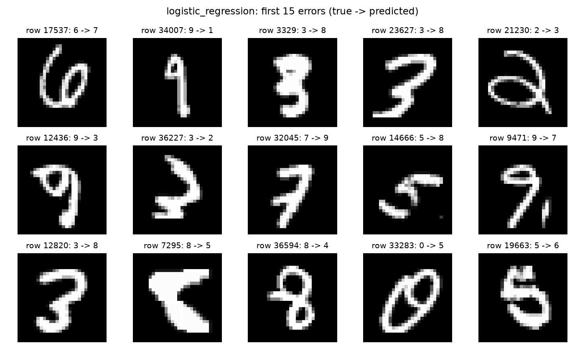
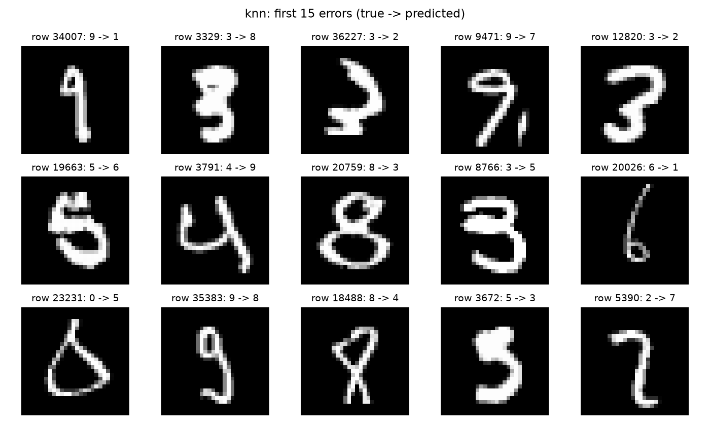
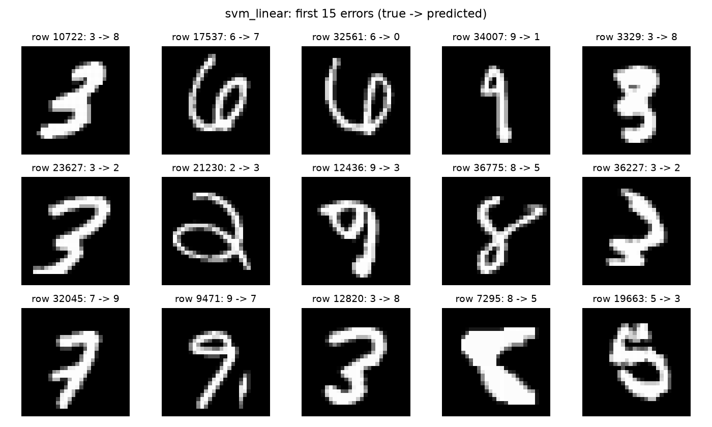
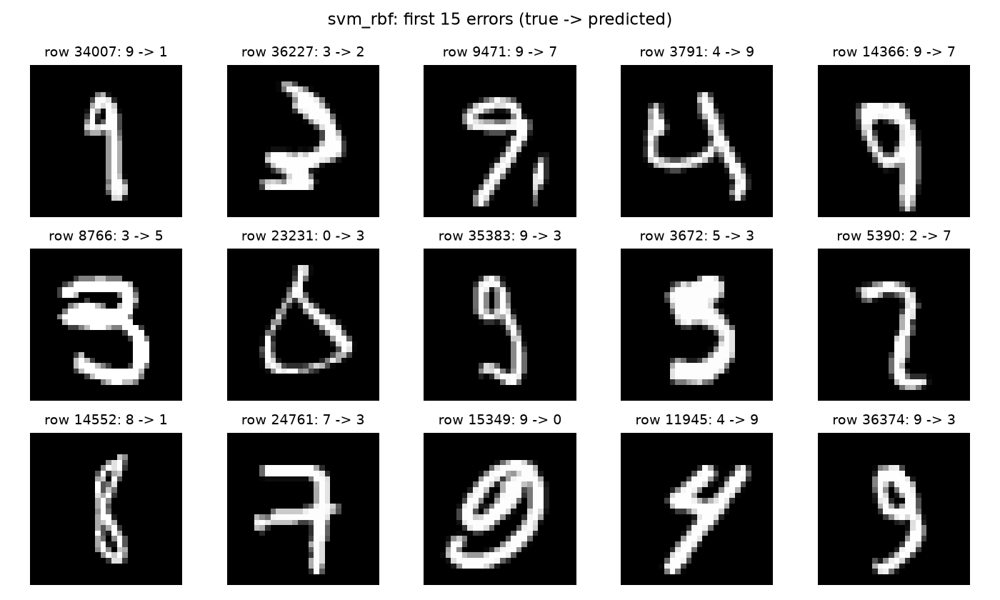
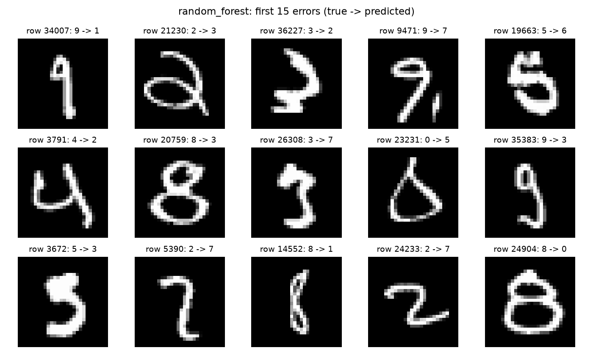

# NV2 — Kết quả thực nghiệm

Không bao gồm phần lý thuyết.

Dữ liệu: 29,400 train / 6,300 validation / 6,300 test; seed 42.
Pixel /255, không augmentation. GridSearchCV 3 fold trên 6,000 ảnh train; fit cuối trên toàn bộ train.
CV phục vụ chọn tham số, không phải ước lượng độc lập. Tập test được giữ lại trong lần thực nghiệm này; dữ liệu nguồn đã từng được dùng ở các thí nghiệm cũ.

**Mô hình chọn theo validation trước khi mở test: svm_rbf.**

| Mô hình | Accuracy | Precision macro | Recall macro | F1 macro | Fit (s) | Predict test (s) | File (MiB) |
|---|---:|---:|---:|---:|---:|---:|---:|
| logistic_regression | 91.43% | 0.9134 | 0.9130 | 0.9131 | 3.69 | 0.00 | 0.03 |
| knn | 96.67% | 0.9670 | 0.9661 | 0.9663 | 0.01 | 3.75 | 8.20 |
| svm_linear | 93.48% | 0.9343 | 0.9337 | 0.9338 | 25.62 | 7.21 | 2.58 |
| svm_rbf | 97.67% | 0.9765 | 0.9764 | 0.9765 | 34.12 | 17.55 | 3.28 |
| random_forest | 96.10% | 0.9606 | 0.9605 | 0.9605 | 16.45 | 0.14 | 18.65 |

Thời gian fit cuối không bao gồm tìm tham số. Thời gian predict là một lần dự đoán cả tập test, không gồm tải model; phụ thuộc máy và số luồng. Kích thước là file joblib nén mức 3, không phải RAM lúc chạy.

Accuracy test cao nhất trong các mô hình đã có: **svm_rbf (97.67%)**. Không dùng kết quả test để tuning lại.

## Tham số và cảnh báo

- logistic_regression: `{'C': 0.1}`; CV accuracy 89.93% ± 0.33%; tìm tham số 5.0s.
- knn: `{'n_neighbors': 3, 'weights': 'distance'}`; CV accuracy 93.30% ± 0.46%; tìm tham số 3.4s.
- svm_linear: `{'C': 0.1}`; CV accuracy 91.72% ± 0.21%; tìm tham số 4.2s.
- svm_rbf: `{'C': 5.0, 'gamma': 'scale'}`; CV accuracy 96.13% ± 0.18%; tìm tham số 22.6s.
- random_forest: `{'max_depth': None, 'max_features': 'sqrt'}`; CV accuracy 94.02% ± 0.47%; tìm tham số 46.6s.

## Phân tích lỗi

Ảnh sai và mã dòng gốc được lưu riêng cho từng mô hình. true → predicted trong hình là nhãn thật → dự đoán.

### logistic_regression
Sai 540/6300 ảnh. Các cặp nhầm nhiều nhất: 9→7: 27 ảnh; 5→3: 26 ảnh; 7→9: 24 ảnh; 8→5: 21 ảnh; 4→9: 21 ảnh.

### knn
Sai 210/6300 ảnh. Các cặp nhầm nhiều nhất: 4→9: 13 ảnh; 8→3: 12 ảnh; 9→7: 10 ảnh; 8→1: 10 ảnh; 9→4: 9 ảnh.

### svm_linear
Sai 411/6300 ảnh. Các cặp nhầm nhiều nhất: 5→3: 27 ảnh; 9→4: 26 ảnh; 9→7: 23 ảnh; 8→5: 20 ảnh; 4→9: 17 ảnh.

### svm_rbf
Sai 147/6300 ảnh. Các cặp nhầm nhiều nhất: 9→7: 8 ảnh; 9→4: 8 ảnh; 4→9: 8 ảnh; 3→2: 7 ảnh; 3→5: 6 ảnh.

### random_forest
Sai 246/6300 ảnh. Các cặp nhầm nhiều nhất: 4→9: 13 ảnh; 9→7: 10 ảnh; 9→4: 10 ảnh; 8→9: 10 ảnh; 3→2: 10 ảnh.

Nhận xét nguyên nhân theo ảnh mẫu được ghi riêng trong error_analysis.md sau khi kiểm tra trực quan. Các nguyên nhân là giả thuyết, không phải kết luận nhân quả.

## Phối hợp NV1 và NV3

Dùng shared_data.npz và split_indices.npz để giữ cùng ảnh/cùng thứ tự. NV3 reshape thành (n,28,28,1); chỉ train/validation được dùng để chọn CNN.
CNN: chưa có mô hình/dự đoán từ NV3; chưa thể kết luận mô hình tốt nhất toàn nhóm.

Per-class precision/recall/F1 và OvR accuracy nằm trong test_classification_report.csv. Recall của một chữ số chính là tỷ lệ dự đoán đúng trong các ảnh thật của chữ số đó.
