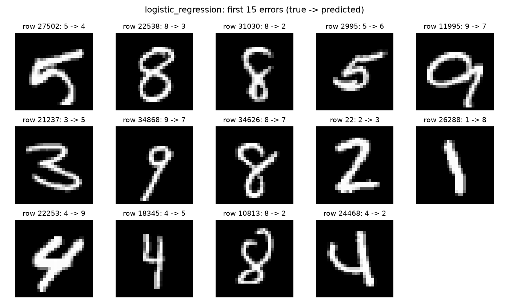
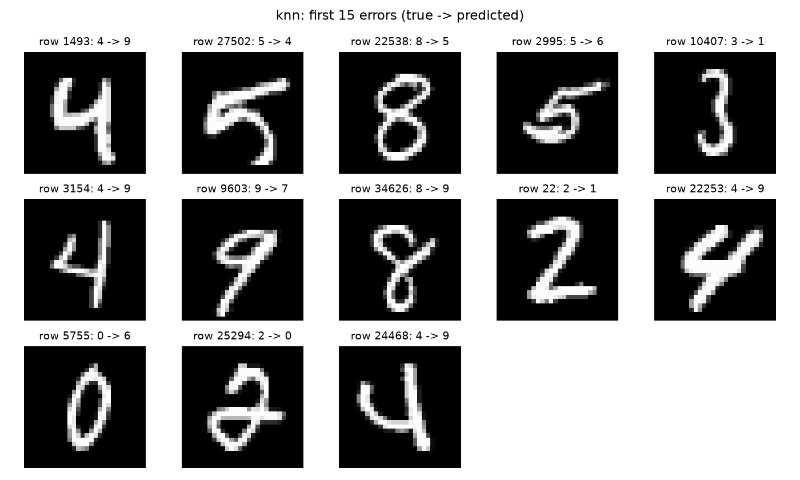
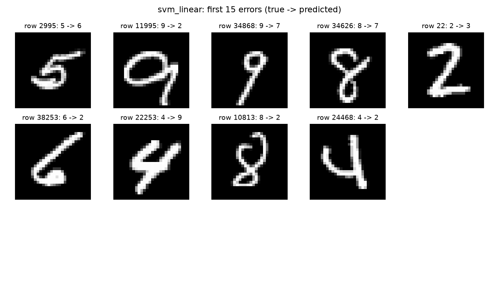
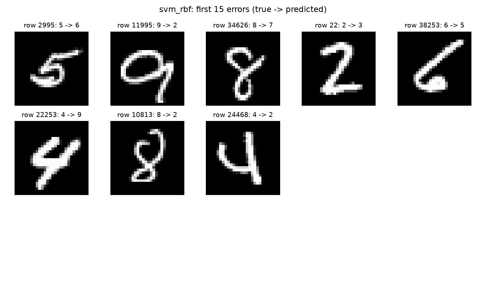
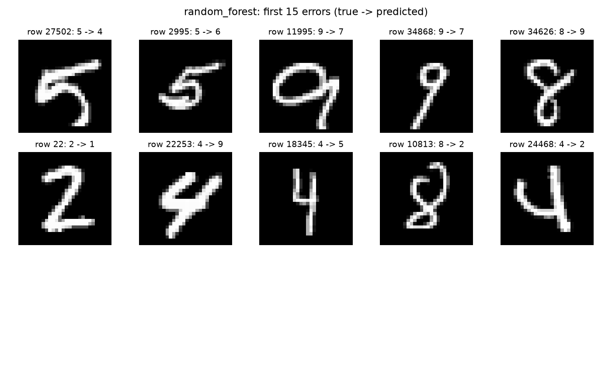

# NV2 — Kết quả thực nghiệm

Không bao gồm phần lý thuyết.

Dữ liệu: 350 train / 75 validation / 75 test; seed 42.
Pixel /255, không augmentation. GridSearchCV 3 fold trên 300 ảnh train; fit cuối trên toàn bộ train.
CV phục vụ chọn tham số, không phải ước lượng độc lập. Tập test được giữ lại trong lần thực nghiệm này; dữ liệu nguồn đã từng được dùng ở các thí nghiệm cũ.

**Mô hình chọn theo validation trước khi mở test: knn.**

| Mô hình | Accuracy | Precision macro | Recall macro | F1 macro | Fit (s) | Predict test (s) | File (MiB) |
|---|---:|---:|---:|---:|---:|---:|---:|
| logistic_regression | 81.33% | 0.8211 | 0.8107 | 0.8053 | 0.07 | 0.00 | 0.02 |
| knn | 82.67% | 0.8503 | 0.8268 | 0.8237 | 0.00 | 0.00 | 0.10 |
| svm_linear | 88.00% | 0.9016 | 0.8768 | 0.8807 | 0.02 | 0.00 | 0.12 |
| svm_rbf | 89.33% | 0.9049 | 0.8911 | 0.8922 | 0.03 | 0.01 | 0.14 |
| random_forest | 86.67% | 0.8723 | 0.8643 | 0.8618 | 0.22 | 0.01 | 0.51 |

Thời gian fit cuối không bao gồm tìm tham số. Thời gian predict là một lần dự đoán cả tập test, không gồm tải model; phụ thuộc máy và số luồng. Kích thước là file joblib nén mức 3, không phải RAM lúc chạy.

Accuracy test cao nhất trong các mô hình đã có: **svm_rbf (89.33%)**. Không dùng kết quả test để tuning lại.

## Tham số và cảnh báo

- logistic_regression: `{'C': 10.0}`; CV accuracy 80.00% ± 2.16%; tìm tham số 0.6s.
- knn: `{'n_neighbors': 5, 'weights': 'distance'}`; CV accuracy 77.33% ± 1.25%; tìm tham số 0.1s.
- svm_linear: `{'C': 0.1}`; CV accuracy 81.67% ± 3.86%; tìm tham số 0.1s.
- svm_rbf: `{'C': 5.0, 'gamma': 'scale'}`; CV accuracy 84.67% ± 1.70%; tìm tham số 0.2s.
- random_forest: `{'max_depth': None, 'max_features': 'sqrt'}`; CV accuracy 80.33% ± 0.94%; tìm tham số 3.0s.

## Phân tích lỗi

Ảnh sai và mã dòng gốc được lưu riêng cho từng mô hình. true → predicted trong hình là nhãn thật → dự đoán.

### logistic_regression
Sai 14/75 ảnh. Các cặp nhầm nhiều nhất: 9→7: 2 ảnh; 8→2: 2 ảnh; 8→7: 1 ảnh; 8→3: 1 ảnh; 5→6: 1 ảnh.

### knn
Sai 13/75 ảnh. Các cặp nhầm nhiều nhất: 4→9: 4 ảnh; 9→7: 1 ảnh; 8→9: 1 ảnh; 8→5: 1 ảnh; 5→6: 1 ảnh.

### svm_linear
Sai 9/75 ảnh. Các cặp nhầm nhiều nhất: 9→7: 1 ảnh; 9→2: 1 ảnh; 8→7: 1 ảnh; 8→2: 1 ảnh; 6→2: 1 ảnh.

### svm_rbf
Sai 8/75 ảnh. Các cặp nhầm nhiều nhất: 9→2: 1 ảnh; 8→7: 1 ảnh; 8→2: 1 ảnh; 6→5: 1 ảnh; 5→6: 1 ảnh.

### random_forest
Sai 10/75 ảnh. Các cặp nhầm nhiều nhất: 9→7: 2 ảnh; 8→9: 1 ảnh; 8→2: 1 ảnh; 5→6: 1 ảnh; 5→4: 1 ảnh.

Nhận xét nguyên nhân theo ảnh mẫu được ghi riêng trong error_analysis.md sau khi kiểm tra trực quan. Các nguyên nhân là giả thuyết, không phải kết luận nhân quả.

## Phối hợp NV1 và NV3

Dùng shared_data.npz và split_indices.npz để giữ cùng ảnh/cùng thứ tự. NV3 reshape thành (n,28,28,1); chỉ train/validation được dùng để chọn CNN.
CNN: chưa có mô hình/dự đoán từ NV3; chưa thể kết luận mô hình tốt nhất toàn nhóm.

Per-class precision/recall/F1 và OvR accuracy nằm trong test_classification_report.csv. Recall của một chữ số chính là tỷ lệ dự đoán đúng trong các ảnh thật của chữ số đó.
